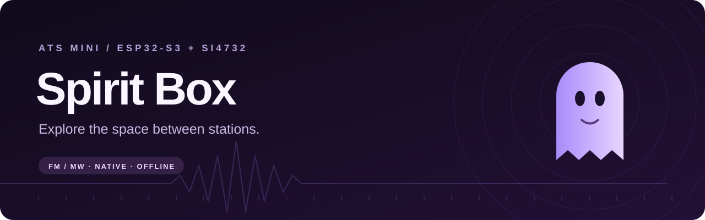
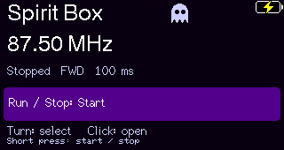
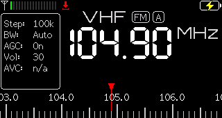

<p align="center">
  
</p>

<p align="center">
  
  
  <a href="https://github.com/esp32-si4732/ats-mini"></a>
  <a href="LICENSE"></a>
</p>

<p align="center">
  A native frequency-sweeping mode for the ESP32-S3 / Si4732 ATS Mini radio.<br>
  Real broadcast radio. Existing controls. A little purple ghost.
</p>

<p align="center">
  <a href="docs/spiritbox/operating.md">Operating guide</a> ·
  <a href="docs/spiritbox/native-installation.md">Hardware test record</a> ·
  <a href="docs/spiritbox/development.md">Development</a> ·
  <a href="https://esp32-si4732.github.io/ats-mini/">Upstream documentation</a>
</p>

## Between the stations

**ATS Mini Spirit Box** adds a Spirit Box entry to the radio's existing menu. Sweep FM or medium-wave AM, change direction and interval, pause on a frequency, then return to normal radio operation. Everything runs on the receiver, fully offline.

The purple-and-black mode theme is temporary. Exit restores your previous theme and normal tuning; the boot splash and saved theme preference stay separate.

<table>
  <tr>
    <td align="center"><br><sub>Spirit Box · temporary purple theme</sub></td>
    <td align="center"><br><sub>Exit · back to normal radio</sub></td>
  </tr>
</table>

*Actual display captures from the development radio. The banner is artwork, not a device photograph.*

## What it does

| Control | Available now |
| --- | --- |
| FM sweep | 87.5–108 MHz · 100 or 50 kHz steps |
| AM / MW sweep | 531–1602 kHz · 9 or 1 kHz steps |
| Sweep interval | 100, 150, 200, 250, 300 or 350 ms, nominal |
| Direction | Forward or reverse, wrapping at band limits |
| Sweep controls | Start, stop and resume with the existing encoder |
| Return to radio | Restore normal band/tuning and remove the temporary theme |
| Connectivity | Existing upstream facilities retained; no cloud connection required |

The mode starts **stopped**, on FM, with 100 kHz steps and a nominal 100 ms interval. AM soft-mute retains the user's setting; squelch is bypassed only while the mode is active. Volume changes remain ordinary radio volume changes.

This is an experimental frequency-sweeping receiver. Audio comes from broadcasts and radio noise; paranormal communication is not an established technical capability of the project.

## Current status

**Working experimental build, installed on one AMNVOLT ATS Mini V4.** Based on upstream **v2.45**, with the custom About label **SB-dev**. The development unit has an ESP32-S3, 16 MiB flash and 8 MiB Octal PSRAM.

Verified on that unit: menu entry and display, FM/MW tuning, start/stop, direction and selected field controls, normal-theme/tuning restoration, a deferred in-mode save, and return to normal radio after reboot. The owner confirmed physical controls and Exit work. A comparison of 68 saved band/VFO and selected preference records matched the pre-install backup.

Audio is still being evaluated: the earlier upstream USB full-band FM trial produced clear station fragments; the native FM build produced some fragments with gaps/static. Native AM tuning is checked, but its audio has not been separately confirmed. Sleep/Off Timer, wireless/web interactions and other edge cases need further hardware validation. See the [full acceptance record](docs/spiritbox/native-installation.md).

**Hardware branding alone does not identify the correct PSRAM variant.** Other ATS Mini revisions have not been validated by this project. This is a community fork, unaffiliated with AMNVOLT or the upstream maintainers.

## Using the mode

1. Open **Menu → Spirit Box**.
2. Turn the encoder to select a field. Click to edit, turn to change, then click to finish.
3. Click **Run / Stop** to sweep or pause. Short press also starts/stops.
4. Select **Exit** to return to your normal radio state.

Changing band stops the sweep. The [operating guide](docs/spiritbox/operating.md) covers ranges, temporary settings and remaining checks.

## Build and recovery

Firmware stays in [`ats-mini/`](ats-mini/), project notes in [`docs/spiritbox/`](docs/spiritbox/), and backup/USB experiment utilities in [`tools/spiritbox/`](tools/spiritbox/).

Read the [development setup](docs/spiritbox/development.md) and upstream [development instructions](docs/source/development.md). Build **only the profile confirmed for your receiver**:

```sh
# Octal PSRAM — used by the development unit
arduino-cli compile --warnings all --profile esp32s3-ospi ats-mini

# Quad PSRAM — separate upstream profile; not validated on this unit
arduino-cli compile --warnings all --profile esp32s3-qspi ats-mini
```

The profiles pin the platform and library versions. These commands compile without uploading. The [native build record](docs/spiritbox/build.md) lists the tested source commit, image size and dependency warnings.

**Back up the complete original flash before installing firmware.** Verify the measured size and SHA-256, keep a recovery copy outside the checkout, and confirm a recovery route. See the [backup/recovery guide](docs/spiritbox/backup-recovery.md) and [upstream flashing instructions](https://esp32-si4732.github.io/ats-mini/flash.html).

There is no published Spirit Box binary release yet. [Upstream releases](https://github.com/esp32-si4732/ats-mini/releases) contain the original firmware, without this fork's Spirit Box mode. Local build artifacts, logs and device backups are excluded from Git; firmware dumps can contain credentials and personal settings.

## Upstream first

This project extends [esp32-si4732/ats-mini](https://github.com/esp32-si4732/ats-mini), preserving its history, license and normal radio functionality. Project changes live on `spiritbox`; the original source layout stays intact. The [technical decisions](docs/spiritbox/decisions.md) and [integration notes](docs/spiritbox/integration.md) document the approach.

Please raise Spirit Box-specific bugs or ideas in [this fork's issues](https://github.com/justinshoesmith/ats-mini-spiritbox/issues). For the upstream radio project, see its [documentation](https://esp32-si4732.github.io/ats-mini/) and [discussions](https://github.com/esp32-si4732/ats-mini/discussions). General community chat: [TalkRadio on Telegram](https://t.me/talkradio/174172).

With thanks to the ATS Mini community and the projects credited by upstream:

- [Volos Projects](https://github.com/VolosR/TEmbedFMRadio)
- [PU2CLR / Ricardo Caratti](https://github.com/pu2clr/SI4735)
- [Ralph Xavier](https://github.com/ralphxavier/SI4735)
- [Goshante](https://github.com/goshante/ats20_ats_ex)
- [G8PTN / Dave](https://github.com/G8PTN/ATS_MINI)
- Sunnygold, Zooc, R9UCL / Max Arnold, Marat Fayzullin and the upstream contributors

The upstream [MIT license](LICENSE) and copyright notices are retained.
